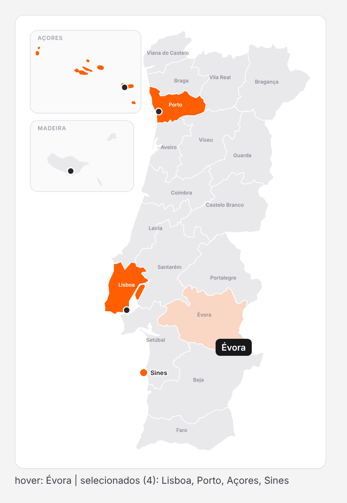

# Portugal map code component (PCF)

`PortugalMap` is the code-component version of `cmpPortugalMap`. Because it's real HTML/SVG, it gets what a canvas component can't: **hovering a district highlights the whole district** and shows a tooltip. Pins grow and show their names on hover. The district or pin under the mouse is also sent back to the app (`HoveredName`), so a label elsewhere on the screen can show it live.



Other features:

- **Map:** the same map as the canvas version: 18 districts, with the Azores and Madeira in boxes. Hovering or clicking anywhere in a box acts on that region.
- **Selection:** click to select, click again to clear. `MultiSelect` and `SelectRegions` work as in the canvas version.
- **Keyboard:** Tab moves between districts and pins, and Enter or Space selects.
- **Sizing:** the map scales to whatever size the control has on the screen.

## Files

| File | Use |
|---|---|
| `PortugalMap/ControlManifest.Input.xml` | Control definition: properties shown in Power Apps |
| `PortugalMap/index.ts` | Control code (rendering, hover, selection, outputs) |
| `PortugalMap/mapData.ts` | District shapes and projections (generated, don't edit) |
| `PortugalMap/css/PortugalMap.css` | Styles, including the hover and selection colours |

## Build it

This needs, on your computer: [Node.js LTS](https://nodejs.org), the [.NET 8 SDK](https://dotnet.microsoft.com/download) and the Power Platform CLI (`dotnet tool install --global Microsoft.PowerApps.CLI.Tool`).

1. Create an empty project with the official template:

   ```
   mkdir PortugalMapControl
   cd PortugalMapControl
   pac pcf init --namespace Pricing --name PortugalMap --template field --run-npm-install
   ```

2. Copy the 4 files from this repo's `pcf/PortugalMap/` over the ones in the generated `PortugalMap/` folder, keeping the `css/` subfolder.
3. Build it with `npm run build`. To try it in the browser test harness first, run `npm start watch`.

## Put it in your environment

1. An admin must allow code components in canvas apps: **Power Platform admin center** → your environment → **Settings** → **Product** → **Features** → turn on **Allow publishing of canvas apps with code components**.
2. Sign in to the environment and push the control:

   ```
   pac auth create --environment https://<your-org>.crm4.dynamics.com
   pac pcf push --publisher-prefix pri
   ```

   To move it between environments (DEV → TEST → PROD), package it in a solution instead: `pac solution init`, then `pac solution add-reference --path <folder with the .pcfproj>`, then `dotnet build`. Import the resulting zip.

3. In Power Apps Studio: **Insert** → **Get more components** → **Code** → pick **PortugalMap** → **Import**. It then appears under **Insert** → **Code components**.

## Use it on a screen

| Property | Example | Meaning |
|---|---|---|
| `PlacesJson` | `JSON(ShowColumns(colLocais, ID, Name, Latitude, Longitude))` | Pins; leave blank for districts only |
| `SelectedIds` | `""` or `"PT-11|L03"` | Starting selection (district IDs are `PT-01`…`PT-18`, `PT-20` Açores, `PT-30` Madeira) |
| `SelectRegions` | `true` | `false` = only pins can be selected |
| `MultiSelect` | `true` | `false` = one selection at a time |
| `ShowLabels` | `true` | District names on the map |
| `AccentColor` | `"#FF5F00"` | Hex colour for selection; the hover colour is a lighter mix of it |

Read the results from the control, for example `PortugalMap1`:

- `PortugalMap1.SelectedIds`: for example `"PT-13|L03"`. To get them as a table, use `Split(PortugalMap1.SelectedIds, "|")`.
- `PortugalMap1.SelectedNames` and `PortugalMap1.SelectedCount`.
- `PortugalMap1.HoveredId` and `PortugalMap1.HoveredName`: what's under the mouse right now. For example, a label with `Text: =Coalesce(PortugalMap1.HoveredName, "Passe o rato sobre o mapa")`.
- Use `PortugalMap1.OnChange` to react whenever the selection changes.

To clear the selection from the app, set `SelectedIds` from a variable and set that variable to `""`.
